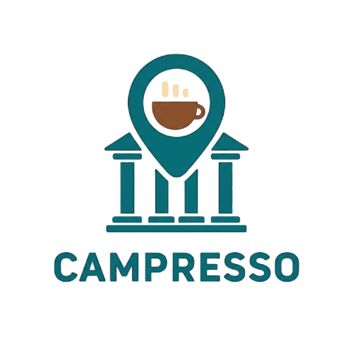
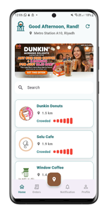
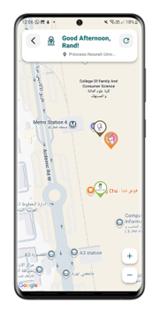
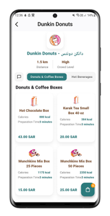
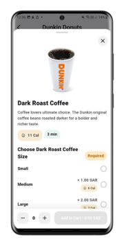
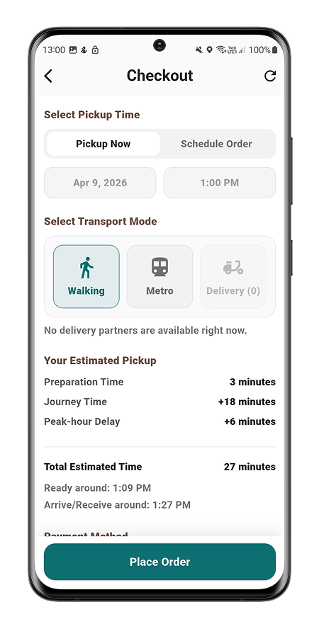
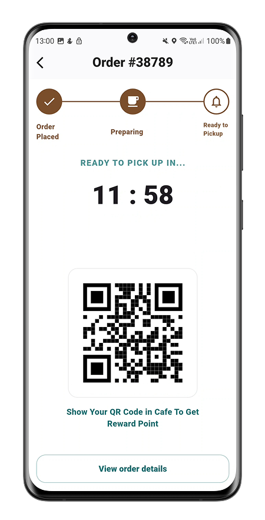
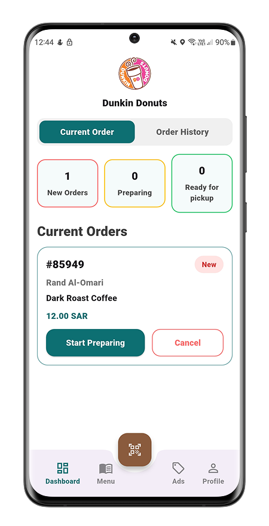
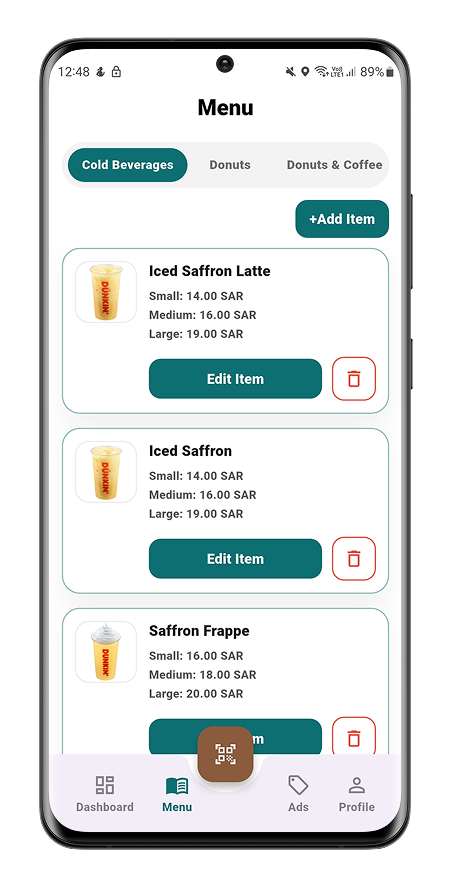
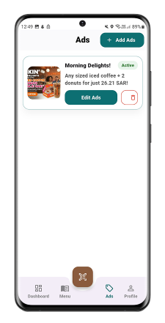

  

# ☕ Campresso

### Smart Campus Café Ordering & Crowd Prediction Application

**Graduation Project | Princess Nourah bint Abdulrahman University (PNU) | 2026**

Campresso is a Flutter-based mobile application designed to improve the campus café experience by reducing waiting times, streamlining orders, and helping students and staff manage their short breaks more efficiently.

The application combines mobile ordering, pickup scheduling, delivery coordination, and machine learning-based crowd prediction in a unified platform.

## The Problem

Students and staff often have limited breaks between classes, while café queues and preparation times can make ordering inconvenient.

Campresso addresses this challenge by allowing users to explore campus cafés, estimate waiting times, and place orders in advance.

## Key Features

### Customer Application
- Browse campus cafés and their menus.
- Customize products and place orders.
- Schedule pickup or order for immediate preparation.
- View estimated preparation and travel times.
- Choose between walking, metro, and delivery options.
- Track orders and receive status notifications.
- Use QR codes for order pickup.
- Access Arabic and English interfaces.

### Café Staff Dashboard
- Receive and manage customer orders.
- Update preparation and order statuses.
- Scan QR codes to confirm pickup.
- View current and historical orders.
- Manage café advertisements.

### Delivery Coordination
- Allow eligible users to participate as delivery partners.
- Match delivery requests with available partners.
- Track delivery acceptance and progress.
- Calculate delivery incentives based on distance.

### Crowd Prediction
- Integrate TensorFlow Lite for on-device crowd-level prediction.
- Use historical and time-based patterns to estimate café crowd levels.
- Help users make more informed ordering decisions.

## Technology Stack

| Category | Technologies |
|---|---|
| Mobile Development | Flutter, Dart |
| Backend | Firebase Authentication, Cloud Firestore, Cloud Functions |
| Machine Learning | TensorFlow Lite |
| Maps & Location | Google Maps, Geolocation |
| Notifications | Firebase Cloud Messaging |
| Development Tools | Android Studio, Git, GitHub |

## My Role

**Team Leader | Lead Flutter Developer | UI/UX Designer**

Campresso was developed as a team graduation project, where I led the technical implementation and took primary responsibility for the hands-on development.

My contributions included:

- Designing the application's UI/UX and user flows.
- Developing the Flutter application and its core features.
- Integrating Firebase services and implementing backend functionality.
- Building customer, café staff, and delivery workflows.
- Integrating the crowd prediction model.
- Implementing order tracking, notifications, and QR-based pickup.
- Conducting functional and performance testing.
- Coordinating development decisions and incorporating team feedback.

## Testing & Performance

The application was evaluated through functional testing and simulated order workloads, including stress testing with over 1,200 test orders.

## Project Recognition

**She Innovates 2026** — Selected among the top 35 projects out of approximately 200 submissions.

## Application Screenshots

### Customer Experience

  
  
  

  
  
  

### Café Staff Experience

  
  
  

## Project Status

Academic graduation project and functional prototype.

The application is not currently deployed for public use. Firebase access is restricted, and additional security configuration is required before any future public deployment.

## Academic Information

**University:** Princess Nourah bint Abdulrahman University  
**College:** College of Computer and Information Sciences  
**Department:** Information Systems  
**Graduation Year:** 2026

---

**Developed and technically led by Rand Al-Omari as part of a collaborative graduation project.**
